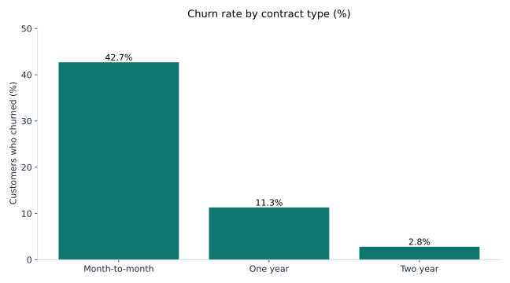
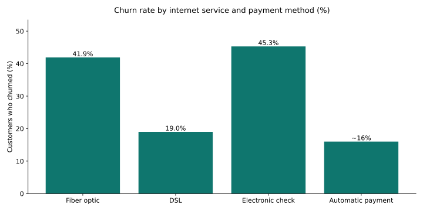

# Customer Churn Analysis — IBM Telco Dataset

Hi, I'm Lovely. I worked as a Data Analyst at JEEVIKA in Bihar, India for 3 years. Now I have an M.S. in Information Systems from Rider University. I live in Jersey City, NJ.

I wanted to know why customers leave a telecom company. This dataset helped me find out.

## The dataset

- IBM Telco Customer Churn dataset, public on Kaggle: https://www.kaggle.com/datasets/blastchar/telco-customer-churn
- File: `WA_Fn-UseC_-Telco-Customer-Churn.csv`. It has 7,043 customers and 21 columns. One row is one customer.
- One honest note. IBM made this dataset for learning. It may not reflect any real telecom company's customers. So this is a portfolio project on a public sample dataset. The findings describe this dataset, not a real company.

## What's in this repo

- `notebooks/01-churn-analysis.ipynb`: the full analysis in Python (pandas, matplotlib)
- `sql/churn_segments.sql`: the same key questions answered in SQL (SQLite-compatible)
- `assets/`: the charts from this README
- `data/DATA_SOURCE.md`: where to download the CSV
- `requirements.txt`: Python packages

## How to run it

1. Download the CSV from the Kaggle link above into `data/`.
2. `pip install -r requirements.txt`
3. Open `notebooks/01-churn-analysis.ipynb` and run it top to bottom.

## What I found

1,869 of 7,043 customers churned. That is 26.54%. About 1 in 4 customers left.

**Contract type matters most.** Month-to-month customers churn at 42.7%. One-year customers churn at 11.3%. Two-year customers churn at 2.8%. Month-to-month customers are about 15x more likely to leave than two-year customers. That surprised me. It was the biggest gap in the whole dataset.

**Internet service matters too.** Fiber optic customers churn at 41.9%. DSL customers churn at 19.0%. Fiber customers pay more and still leave more. That points to a service problem, not a price problem.

**Payment method matters.** Electronic check users churn at 45.3%. Automatic bank transfer or credit card users churn at about 15 to 17%. That is a big difference for something as small as how you pay.

**New customers leave fastest.** 47.4% of customers churn in their first 12 months. About 52% churn in the first 6 months. After 4 years, churn drops to about 8 to 9.5%. Median tenure is 10 months for churned customers and 38 months for customers who stayed.

**The highest-risk group is easy to spot.** Month-to-month customers in their first 12 months churn at 51.4%. Among month-to-month customers, those without TechSupport churn at 50.4%. With TechSupport it is 30.7%.

**Two more things I noticed.** Senior citizens churn at 41.7%, compared to 23.6% for others. And customers who left paid $74.44 a month on average. Customers who stayed paid $61.27. So the customers who leave are the ones paying more.

Churned customers also represent $139,131 in monthly revenue at risk, per a published analysis of this dataset.

## What I would do about it

1. Nudge month-to-month customers onto one-year or two-year contracts. 42.7% churn vs 2.8% is the biggest gap in the data.
2. Protect the first year. With about 52% churning in the first 6 months, check-ins in months 1 to 6 matter most.
3. Look at fiber optic service quality. Fiber customers churn at 41.9% vs 19.0% for DSL.
4. Move electronic-check payers to autopay. And offer TechSupport to month-to-month customers. 45.3% vs about 15 to 17% on payment method, and 50.4% vs 30.7% on TechSupport.

## A data problem I found

`TotalCharges` is stored as text. 11 rows have a blank value. All 11 are zero-tenure, brand-new customers. The notebook converts the column to numeric and treats blanks as 0.

## Limitations

- This is a sample dataset made for learning. The patterns describe this dataset. They are associations, not proof of cause.
- There is no complaint, outage, or customer-service data here. So the "why" behind fiber churn and early churn is a question for follow-up. This data cannot answer it on its own.

## Tools

Python (pandas, NumPy, matplotlib), SQL (SQLite).
